
<picture><source media="(prefers-color-scheme: dark)" srcset="assets/header-dark.svg">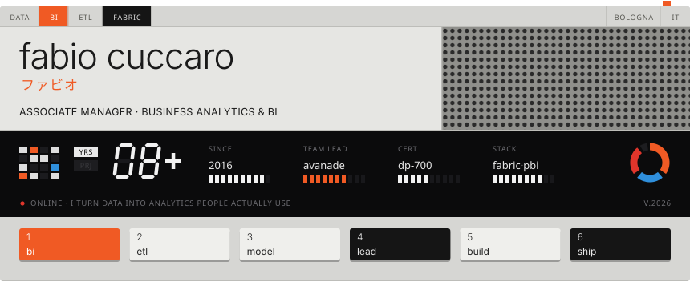</picture>

<a href="https://www.linkedin.com/in/fabio-cuccaro-91007487"><picture><source media="(prefers-color-scheme: dark)" srcset="assets/key-in-dark.svg">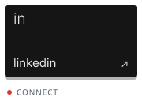</picture></a><a href="mailto:whisperer100@gmail.com"><picture><source media="(prefers-color-scheme: dark)" srcset="assets/key-mail-dark.svg"></picture></a>

<picture><source media="(prefers-color-scheme: dark)" srcset="assets/label-1-dark.svg"></picture>

- **Associate Manager at Avanade** (since 2024): I lead projects and teams delivering analysis and development for data solutions
- 8+ years in Business Analytics, from ETL developer to project lead, always focused on BI, data integration and reporting
- MSc in Management and Information Technology (University of Salerno), BSc in Computer Science (University of Molise)
- Based in Bologna, Italy. On the side I build tools for Linux/Hyprland ([Omarchy](https://omarchy.org)) and tinker with Lua/LÖVE, Strudel and Power BI

<picture><source media="(prefers-color-scheme: dark)" srcset="assets/label-2-dark.svg"></picture>

<a href="https://cedoli.it"><picture><source media="(prefers-color-scheme: dark)" srcset="assets/key-1-dark.svg">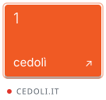</picture></a><a href="#"><picture><source media="(prefers-color-scheme: dark)" srcset="assets/key-2-dark.svg">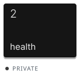</picture></a><a href="https://github.com/FabioCuccaro/omarchy_monitor_manager"><picture><source media="(prefers-color-scheme: dark)" srcset="assets/key-3-dark.svg">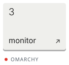</picture></a><a href="https://github.com/FabioCuccaro/omarchy_touchpad_manager"><picture><source media="(prefers-color-scheme: dark)" srcset="assets/key-4-dark.svg">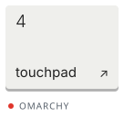</picture></a><a href="https://github.com/FabioCuccaro/ugreen_tailscale"><picture><source media="(prefers-color-scheme: dark)" srcset="assets/key-5-dark.svg">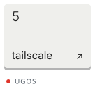</picture></a><a href="https://github.com/FabioCuccaro/ugreen_immich"><picture><source media="(prefers-color-scheme: dark)" srcset="assets/key-6-dark.svg">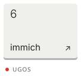</picture></a>

`01` **[Cedolì](https://cedoli.it)** ([source](https://github.com/FabioCuccaro/cedoli)): a free offline app that explains Italian payslips line by line and redoes the math from gross to net. No account, no cloud, no AI. 
`02` **Personal health analytics** (private): an end-to-end BI pipeline on my Oura Ring data. Python ETL to Parquet on my NAS, dashboard with Observable Framework and DuckDB-WASM, plus a Power BI report. 
`03` **[omarchy_monitor_manager](https://github.com/FabioCuccaro/omarchy_monitor_manager)**: arrange your displays visually in the Omarchy shell, try the layout live with automatic rollback. 
`04` **[omarchy_touchpad_manager](https://github.com/FabioCuccaro/omarchy_touchpad_manager)**: live-tune scrolling, pointer, gestures and per-app scroll speed on Hyprland, with profiles. 
`05` **[ugreen_tailscale](https://github.com/FabioCuccaro/ugreen_tailscale)**: reach a UGREEN NAS from anywhere with Tailscale in Docker, no open ports. 
`06` **[ugreen_immich](https://github.com/FabioCuccaro/ugreen_immich)**: self-host Immich on a UGREEN NAS, reading the photos the UGREEN app already syncs.

<picture><source media="(prefers-color-scheme: dark)" srcset="assets/label-3-dark.svg"></picture>

<picture><source media="(prefers-color-scheme: dark)" srcset="assets/stack-dark.svg">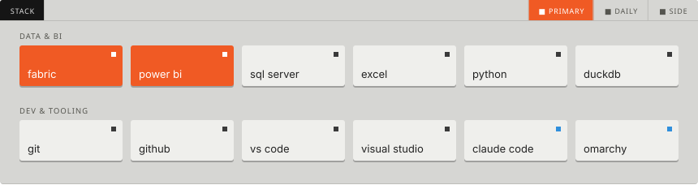</picture>

<picture><source media="(prefers-color-scheme: dark)" srcset="assets/label-4-dark.svg"></picture>

<picture><source media="(prefers-color-scheme: dark)" srcset="assets/homelab-dark.svg">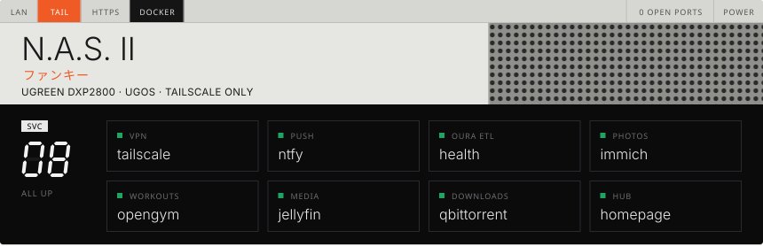</picture>

Every service runs as a Docker Project on UGOS and nothing is exposed to the internet: from outside, everything goes through Tailscale. Guides and compose files in [ugreen_tailscale](https://github.com/FabioCuccaro/ugreen_tailscale) and [ugreen_immich](https://github.com/FabioCuccaro/ugreen_immich).

<picture><source media="(prefers-color-scheme: dark)" srcset="assets/label-5-dark.svg"></picture>

<a href="https://learn.microsoft.com/en-us/users/fabiocuccaro-9952/credentials/ea86da04af07f9ca"><picture><source media="(prefers-color-scheme: dark)" srcset="assets/cert-dark.svg">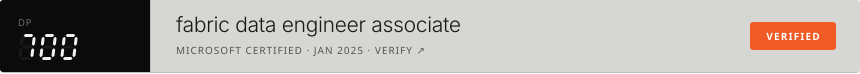</picture></a>

